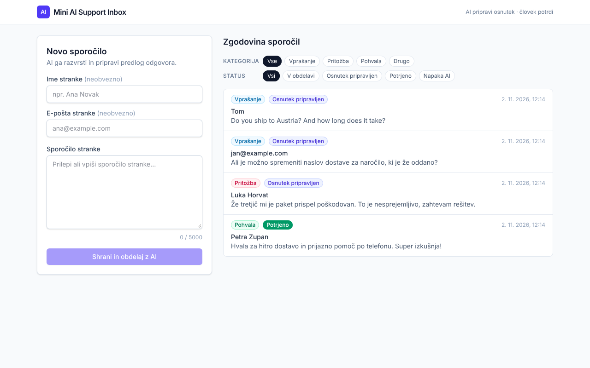
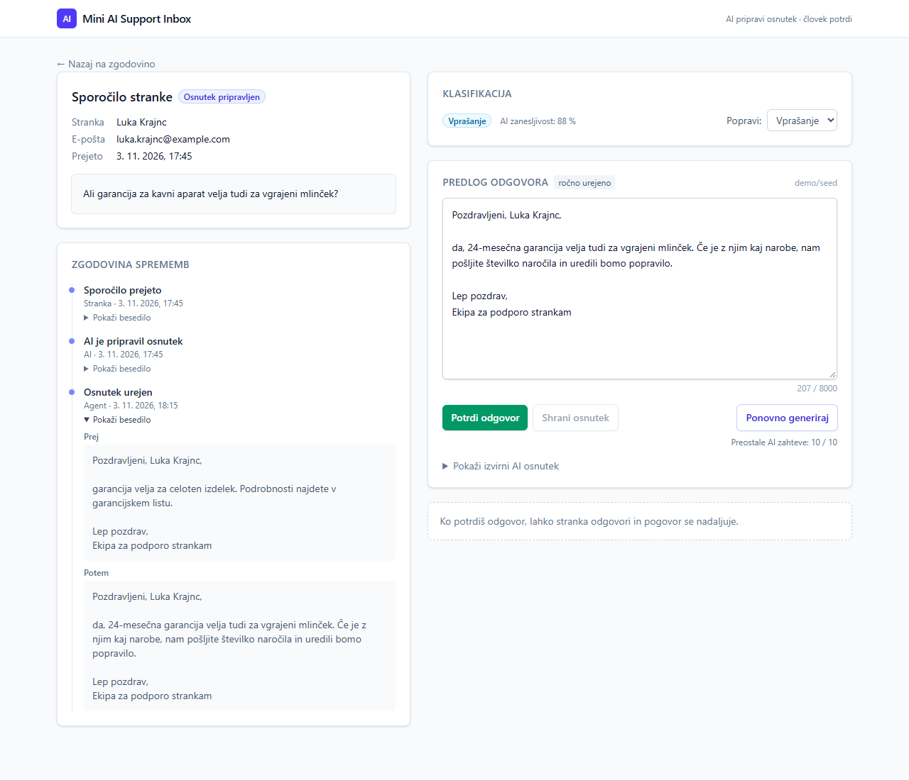
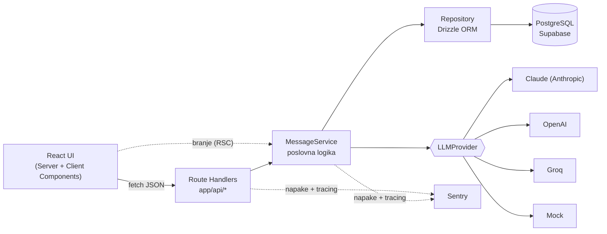
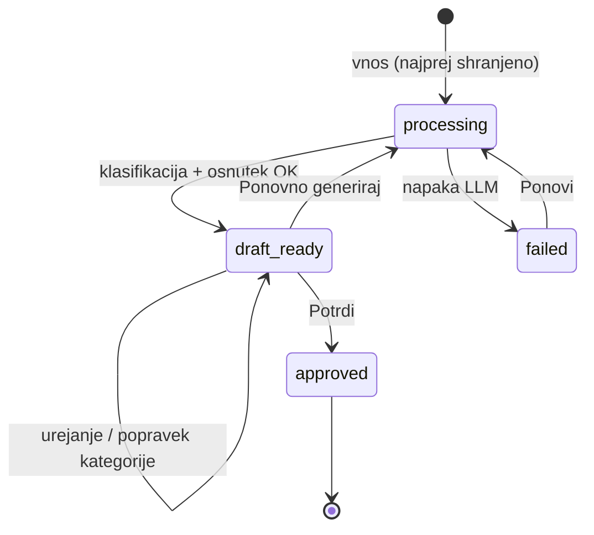

# Mini AI Support Inbox

Spletna aplikacija za obdelavo sporočil strank. **AI razvrsti sporočilo in pripravi predlog odgovora, človek ga uredi in potrdi.**

**Demo:** _<povezava do Vercel deploya>_ · Basic Auth podatki so v e-pošti.



## Funkcionalnosti

- **Vnos sporočila stranke** (ime, e-pošta, besedilo) z validacijo na clientu in serverju
- **AI klasifikacija**: `vprašanje | pritožba | pohvala | drugo` + zanesljivost (structured output, JSON schema)
- **Predlog odgovora z LLM**: ton glede na kategorijo, odgovor v jeziku stranke, brez izmišljenih dejstev (manjkajoči podatki ostanejo kot `[placeholder]`)
- **Shranjevanje** sporočil in odgovorov v PostgreSQL (Supabase)
- **Zgodovina** s filtri po kategoriji in statusu
- **Urejanje in potrditev odgovora**: po potrditvi je odgovor zaklenjen, original AI osnutka ostane shranjen
- Ročni popravek kategorije (ponovno generiranje upošteva človekovo odločitev)
- Ponovno generiranje osnutka ali ponovitev obdelave, če AI pade
- **Sentry**: produkcijske napake (client + server), sledenje LLM klicem, brez osebnih podatkov



## Hiter zagon (lokalno)

Potrebuješ Node.js 22+ in PostgreSQL (lokalni ali Supabase).

```bash
npm install
cp .env.example .env.local        # DATABASE_URL + (neobvezno) ANTHROPIC_API_KEY
docker compose up -d              # lokalni Postgres (ali uporabi Supabase URL)
npm run db:migrate                # ustvari tabele
npm run dev                       # http://localhost:3000
```

**Brez Dockerja:** namesto `docker compose up -d` in `npm run db:migrate` v ločenem terminalu zaženi `npm run db:local` (pravi PostgreSQL 16 iz npm paketa `embedded-postgres`). Tabele ustvari sam, podatke pa hrani v `.pgdata/`.

Brez API ključa aplikacija uporabi **mock LLM provider** (deterministična pravila po ključnih besedah). Tako cel tok deluje offline, v UI pa piše `mock/mock-v1`. Z `ANTHROPIC_API_KEY` (ali `OPENAI_API_KEY`, `GROQ_API_KEY`) se samodejno vklopi pravi model. [Groq](https://console.groq.com) ima brezplačen paket, primeren za preizkus.

V razvojnem načinu ima obrazec še **testne scenarije** (`src/lib/scenarios.ts`): en klik ustvari izmišljeno stranko in njeno sporočilo, ga pošlje skozi običajen tok in odpre pripravljen odgovor. Ko odgovor potrdiš, z gumbom _Generiraj odgovor stranke_ stranka odpiše in AI pripravi naslednji odgovor, dokler se scenarij ne konča. Med scenariji je tudi poskus manipulacije AI (prompt injection).

| Ukaz                                 | Opis                                                                              |
| ------------------------------------ | --------------------------------------------------------------------------------- |
| `npm test`                           | Unit + integracijski testi (Vitest, servis teče proti pravemu Postgresu v PGlite) |
| `npm run typecheck` / `npm run lint` | TypeScript strict / ESLint                                                        |
| `npm run db:generate`                | nova migracija po spremembi sheme                                                 |
| `npm run db:migrate`                 | aplicira migracije iz `drizzle/`                                                  |
| `npm run db:local`                   | Postgres brez Dockerja, tabele ustvari sam, podatki v `.pgdata/`                  |

### Deploy (Vercel + Supabase + Sentry)

1. **Supabase**: ustvari projekt. Pod _Connect_ kopiraj **Transaction pooler** URL (port 6543) za `DATABASE_URL` in **Session pooler/Direct** URL za `DATABASE_MIGRATION_URL`. Nato lokalno zaženi `npm run db:migrate`.
2. **Sentry**: ustvari Next.js projekt in kopiraj DSN (`NEXT_PUBLIC_SENTRY_DSN`). Za source mape dodaj še `SENTRY_ORG`, `SENTRY_PROJECT` in `SENTRY_AUTH_TOKEN`.
3. **Vercel**: uvozi GitHub repozitorij in nastavi env spremenljivke iz `.env.example` (`DATABASE_URL`, `ANTHROPIC_API_KEY`, `BASIC_AUTH_USER`, `BASIC_AUTH_PASSWORD`, Sentry). Nato deploy.
4. Preveri: `GET /api/health` vrne `{"status":"ok","database":"ok"}`.

## Arhitektura



**Sloji** (`src/`):

| Sloj        | Datoteke                                                 | Odgovornost                                                                                                   |
| ----------- | -------------------------------------------------------- | ------------------------------------------------------------------------------------------------------------- |
| UI          | `app/page.tsx`, `app/messages/[id]`, `components/*`      | Server Components berejo podatke (streaming prek `Suspense`), Client Components izvajajo akcije prek REST API |
| HTTP        | `app/api/**/route.ts`, `server/api.ts`, `server/http.ts` | validacija (zod), preverjanje izvora, rate limit, preslikava napak v HTTP kode                                |
| Domena      | `server/messages/service.ts`                             | statusni tok, pravila (urejanje samo osnutkov, potrditev enkrat …)                                            |
| Podatki     | `server/messages/repository.ts`, `server/db/*`           | samo SQL; pogojni UPDATE-i za konsistenco                                                                     |
| AI          | `server/llm/*`                                           | vmesnik `LLMProvider`, prompti, Claude/OpenAI/Groq/mock implementacije                                        |
| Kompozicija | `server/container.ts`                                    | edino mesto, ki pozna konkretne implementacije (DI)                                                           |

**Statusni tok sporočila:**



**Podatkovni model:** `messages` (besedilo, kategorija, zanesljivost, vir kategorije `ai|human`, status, napaka) in `replies` (1:1, `ai_draft` = original LLM, `body` = trenutna verzija, `model`, `prompt_version`, `approved_at`).

### Ključne odločitve

- **Sporočilo se shrani pred klicem LLM-ja.** Če AI pade (timeout, 429, neveljaven output), podatki niso izgubljeni: status je `failed`, uporabnik vidi razlog in gumb »Ponovi«. API vseeno vrne `201`, ker je bil vir ustvarjen.
- **Structured outputs + ponovna zod validacija.** Klasifikacija je omejena na JSON shemo z enumom, rezultat se še enkrat preveri. Modelu ne zaupamo na slepo.
- **Dva ločena LLM klica** (klasifikacija → osnutek): osnutek dobi kategorijo kot kontekst (ton), klasifikacija pa ostane poceni in hitra (`claude-haiku-5-5`, `effort: low`).
- **Človek v zanki:** AI nikoli ne pošlje odgovora sam. Ročni popravek kategorije ima prednost pri ponovnem generiranju.
- **Original AI osnutka se hrani** (`ai_draft` ≠ `body`), tako se da meriti, koliko ljudje popravljajo AI. To je osnova za evals in izboljšave promptov (`prompt_version`).
- **Konsistenca:** prehodi stanj so pogojni UPDATE-i (`WHERE status = 'draft_ready'`), zato dvojna potrditev ali urejanje po potrditvi ni možno niti ob sočasnih zahtevah (`409 Conflict`). Sporočilo, ki obvisi v `processing` (npr. ubit serverless proces), se po 2 min lahko ponovno obdela.
- **En Next.js projekt za frontend in backend.** Jasni sloji, en deploy, deljeni tipi in validacijske sheme med clientom in serverjem.

## REST API

| Metoda  | Pot                                      | Opis                                                             |
| ------- | ---------------------------------------- | ---------------------------------------------------------------- |
| `GET`   | `/api/messages?category=&status=&limit=` | zgodovina (najnovejša najprej)                                   |
| `POST`  | `/api/messages`                          | `{ body, customerName?, customerEmail? }` → shrani + AI obdelava |
| `GET`   | `/api/messages/:id`                      | eno sporočilo z odgovorom                                        |
| `PATCH` | `/api/messages/:id`                      | `{ category }`: ročni popravek kategorije                        |
| `PATCH` | `/api/messages/:id/reply`                | `{ body }`: urejanje osnutka                                     |
| `POST`  | `/api/messages/:id/approve`              | potrditev odgovora                                               |
| `POST`  | `/api/messages/:id/process`              | ponovi obdelavo / ponovno generiraj                              |
| `POST`  | `/api/messages/:id/customer-reply`       | `{ body }`: odgovor stranke, nadaljuje pogovor                   |
| `GET`   | `/api/health`                            | stanje aplikacije in baze                                        |

Napake imajo enotno obliko `{ "error": { "code": "...", "message": "..." } }` in ustrezne kode `400/403/404/409/413/429/500`.

## Varnost

- **Validacija vhodov** z zod (omejitve dolžine, e-pošta, UUID parametri), omejitev velikosti telesa (32 KB), sporočila napak brez internih podrobnosti
- **SQL injection**: samo parametrizirane poizvedbe (Drizzle)
- **XSS**: vsebina strank se izpisuje samo kot tekst (React escaping, brez `dangerouslySetInnerHTML`)
- **Prompt injection**: besedilo stranke je med ločili `<customer_message>`, ki jih stranka ne more zapreti. Model dobi navodilo, naj ga obravnava kot podatke, output je omejen na shemo, človek vedno potrdi.
- **Skrivnosti** samo na serverju (`server-only`, env validacija z zod)
- **Rate limit** na AI endpointih (privzeto 10/min/IP, `RATE_LIMIT_AI_PER_MINUTE`) z `Retry-After`; UI prek `GET /api/ai-quota` pokaže števec preostalih zahtev in zaklene AI gumbe, ko jih zmanjka
- **CSRF**: preverjanje `Origin` pri mutacijah + JSON telo (CORS preflight)
- **Dostop**: HTTP Basic Auth (Next.js `proxy.ts`, primerjava v konstantnem času) za demo
- **Supabase RLS** vklopljen na obeh tabelah (brez politik): javni Data API nima dostopa, aplikacija dostopa kot lastnik tabel
- **Security headerji** (`X-Frame-Options`, `nosniff`, `Referrer-Policy`, osnovni CSP)
- **Zasebnost v Sentryju**: brez teles zahtev, piškotkov, IP-jev, DB parametrov in LLM promptov/odgovorov

## Obravnava napak in observability

- Hierarhija napak (`ValidationError`, `NotFoundError`, `ConflictError`, `RateLimitError`, `LLMError` …) → enoten JSON odgovor
- Napake SDK-jev (timeout, 401, 429, 5xx) se preslikajo v razumljiva sporočila. LLM klici imajo timeout (20 s) in 2 retryja z backoffom (SDK).
- `error.tsx` / `global-error.tsx` / `not-found.tsx` v UI, napake se pošljejo v Sentry
- **Sentry**: `instrumentation.ts` (server, `onRequestError`), `instrumentation-client.ts` (browser), tunnel route proti ad-blockerjem, source mapi ob buildu. LLM klici so instrumentirani (`instrumentAnthropicAiClient`): model, latenca in tokeni, brez vsebine.
- Strukturirani JSON logi brez osebnih podatkov (`ai.processed`, `ai.failed` z `messageId`, `stage`, `durationMs`)

## Testi

`npm test` → 29 testov:

- **Servis** (integracijski, pravi Postgres prek PGlite + produkcijske migracije): celoten tok, AI napaka → `failed` → retry, sledenje urejanju, zaklep po potrditvi, ohranjanje ročne kategorije, obnovitev zastarelega `processing`, filtri
- **LLM provider**: validacija structured outputa, zavrnitve, preslikava napak, ignoriranje thinking blokov
- **Prompt injection** zaščita, rate limiter, validacijske sheme

## Uporaba AI orodij pri razvoju

- **Claude Code (Claude Opus 5.5)** kot pair-programmer v celotnem procesu:
  1. **Najprej plan**: arhitektura, podatkovni model, statusni tok, varnost. Šele nato koda.
  2. **Inkrementalna implementacija** po slojih (glej git zgodovino): baza → LLM sloj → servis/API → UI → Sentry → testi.
  3. **Sprotno preverjanje**: typecheck, lint, testi, produkcijski build in E2E klik skozi aplikacijo v headless brskalniku po vsakem koraku.
  4. Next.js 16 ima precej novosti (Cache Components, `proxy.ts` namesto middleware). Agent je bral dokumentacijo, ki je priložena paketu (`AGENTS.md`), namesto da bi se zanašal na zastarelo znanje.
- **`CLAUDE.md`** v repozitoriju opisuje arhitekturna pravila za nadaljnje delo z AI agenti.
- Moja vloga: odločitve o arhitekturi in obsegu, pregled kode, preverjanje robnih primerov.
- **V produktu**: Claude Haiku 5.5 (hiter in poceni za klasifikacijo/kratke odgovore), structured outputs, verzioniranje promptov.

## Kaj bi še izboljšal

1. **Asinhrona obdelava**: queue (npr. Vercel Queues/Inngest) in streaming osnutka (SSE) namesto sinhronega klica (~2–4 s)
2. **Avtentikacija in vloge** (Supabase Auth/SSO) + audit log (kdo je urejal/potrdil)
3. **Evals**: zlati nabor sporočil za klasifikacijo v CI, metrika »edit distance« med `ai_draft` in potrjenim odgovorom po verziji prompta
4. **RAG nad bazo znanja/FAQ**, da osnutki vsebujejo prava dejstva namesto placeholderjev
5. **Integracija z e-pošto/helpdeskom**: inbound webhook, pošiljanje potrjenega odgovora, niti pogovorov
6. **Porazdeljen rate limit** (Redis/Upstash), ker je trenutni per-instance
7. Paginacija s kursorjem, iskanje (Postgres full-text), prioritizacija/sentiment
8. Strožji CSP z nonce, Playwright E2E testi v CI, redakcija PII pred pošiljanjem LLM-ju
